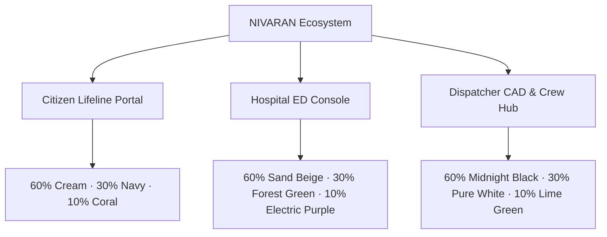

# NIVARAN — Comprehensive Design System & UI/UX Architecture

**Author:** Lead Product Designer & Senior UI/UX Engineer  
**Standard:** WCAG 2.2 Level AA / APCA (Lc 60+) Compliance  
**Design Intelligence:** Powered by `ui-ux-design-pro-skill`  
**Brand Philosophy:** High-stakes Emergency Precision — Reassuring for citizens, hyper-functional for clinicians, mission-critical for dispatchers.

---

## 1. Ecosystem Portals & Design Directions



### A. Citizen Emergency Portal (`:3000`)
* **Design Direction:** *Calm Emergency & Minimal Tactility*
* **Psychological Intent:** Citizens accessing this portal are in acute distress, panic, or witnessing life-threatening trauma. The UI must eliminate cognitive friction, avoid confusing choices, prioritize one-touch dispatch, and offer tactile reassurance.
* **Palette:**
  * **60% Cream (`#F4EDE0` / `#FAF5EC`):** Warm, grounded, calming canvas that reduces visual panic compared to sterile white.
  * **30% Navy (`#14213D` / `#0E182D`):** Authoritative, trustworthy structure for headers, typography, and navigation.
  * **10% Coral (`#FF6B5B` / `#B91C1C`):** High-salience focal point for the 1-second hold SOS trigger and critical alerts.

### B. Hospital Emergency Receiving Portal (`:3002`)
* **Design Direction:** *Clinical Precision Operations*
* **Psychological Intent:** Emergency department triage chiefs and trauma leads need rapid situational awareness without glare or distraction. Patient vitals, incoming ETAs, and bed capacities must be parseable in sub-second glances.
* **Palette:**
  * **60% Sand Beige (`#E8DCC4` / `#F2EADA`):** Low eye-strain, non-glare clinical warmth for cards, metrics, and queues.
  * **30% Forest Green (`#1F3D2B` / `#14281C`):** Clinical authority, structural sidebars, section headers, and contrast frames.
  * **10% Electric Purple (`#8B5CF6` / `#7C3AED`):** AI clinical triage highlights, live telemetry pulses, and active category states.

### C. Dispatcher Command Console & Ambulance Crew Hub (`:3001` & `/crew`)
* **Design Direction:** *Aviation / Tactical CAD Command*
* **Psychological Intent:** Command dispatchers and mobile ambulance drivers operate in high-tempo, often dimly-lit control rooms or moving cabs. Information density must be maximal yet strictly partitioned, with zero text collision and unmistakable action affordance.
* **Palette:**
  * **60% Midnight Black (`#0B0B0C` / `#121316` / `#181A1F`):** Military/aviation OLED dark canvas eliminating eye fatigue.
  * **30% Pure White (`#FFFFFF` / `rgba(255,255,255,0.75)`):** Razor-sharp typographic readability, tabular metadata, and borders.
  * **10% Lime Green (`#C6F432` / `#AEE01E`):** Primary dispatch triggers, route recommendations, and live synchronization heartbeats.

---

## 2. Token Architecture & Naming Conventions

All applications use a three-tier CSS Custom Property hierarchy (`primitives` → `semantics` → `components`):

```css
/* Primitives */
--color-{hue}-{step}
--space-{index}
--radius-{size}

/* Semantics */
--color-surface-base
--color-surface-raised
--color-surface-overlay
--color-text-primary
--color-text-secondary
--color-text-muted
--color-border-default
--color-border-focus
--color-accent

/* Components */
--button-height-sm: 28px;
--button-height-md: 36px;
--button-height-lg: 48px;
--input-height: 40px;
--touch-target-min: 44px;
```

---

## 3. Typography Scale & Pairings

We implement a **Major Third (1.250)** modular scale:

| Token | Size | Line Height | Tracking | Usage |
| :--- | :--- | :--- | :--- | :--- |
| `--font-xs` | `11px / 0.6875rem` | `1` | `+0.05em` | Badges, all-caps metadata |
| `--font-sm` | `12px / 0.75rem` | `1.25` | `+0.02em` | Input labels, secondary notes |
| `--font-base` | `14px / 0.875rem` | `1.4` | `0` | Dense CAD tables, body text |
| `--font-md` | `16px / 1.00rem` | `1.5` | `0` | Comfortable descriptions, cards |
| `--font-lg` | `18px / 1.125rem` | `1.3` | `-0.015em` | Card titles, section headers |
| `--font-xl` | `20px / 1.25rem` | `1.25` | `-0.02em` | Main titles, triage conditions |
| `--font-2xl` | `24px / 1.50rem` | `1.2` | `-0.025em` | Command hub title, ETA display |
| `--font-3xl` | `32px / 2.00rem` | `1.1` | `-0.03em` | Metric counters, SOS label |

### Font Families
- **Display & Headlines:** `Plus Jakarta Sans`, sans-serif (`font-headline`)
- **Body & Controls:** `Inter`, -apple-system, BlinkMacSystemFont, sans-serif (`font-sans`)
- **Data, GPS & Numerics:** `JetBrains Mono`, monospace (`font-mono`, `.font-tabular`)

> [!IMPORTANT]
> **Numeric Stability Rule:** All live timers, speed gauges, ETA countdowns, and clinical vital signs must apply `.font-tabular` (`font-variant-numeric: tabular-nums lining-nums;`) to prevent layout shift during countdowns.

---

## 4. Spacing & Layout Grid Scale

Built on an 8pt spatial grid with 4pt micro-adjustments:

```css
--space-0-5: 2px;
--space-1:   4px;
--space-2:   8px;
--space-3:   12px;
--space-4:   16px;
--space-5:   20px;
--space-6:   24px;
--space-8:   32px;
--space-12:  48px;
```

### Layout Breakpoints
- **Mobile (`< 640px`):** Single-column stack, thumb-zone primary interactions, fixed bottom navigation.
- **Tablet (`640px – 1024px`):** 2-column operational layout, collapsible navigation drawers.
- **Desktop (`> 1024px`):** Multi-pane split:
  - Fixed header (64px)
  - Collapsible operational sidebar (256px)
  - Primary queue & live cards (7-column / 60% viewport)
  - Tactical inspector & telemetry bridge (5-column / 40% viewport)

---

## 5. Component Patterns & States

### Button Variants
1. **Primary Tactical Action:**
   - Dispatcher: `bg-[#C6F432] text-[#0B0B0C] hover:bg-[#AEE01E] font-extrabold`
   - Hospital: `bg-[#1F3D2B] text-white hover:bg-[#0E1B13] font-bold`
   - Citizen: `bg-[#B91C1C] text-white hover:bg-[#991B1B] font-bold`
2. **Interactive Toggles:**
   - Elevated pill (`bg-[#1F3D2B]/80 hover:bg-[#1F3D2B] border border-white/10`)
   - High-contrast text label with active colored status beacon (`● READY`, `● STANDBY`).
3. **Ghost / Tertiary:**
   - Subtle border, transparent background, bright on hover.
4. **Interactive States:**
   - `:hover`: `brightness(0.95)` or accent background tint
   - `:active`: `transform: scale(0.98)`
   - `:focus-visible`: `outline: 2px solid var(--color-border-focus); outline-offset: 2px;`

---

## 6. Motion, Animation & Reduced Motion

- **Durations:** Micro-interactions (150ms), Card transitions (250ms), Modal fades (300ms).
- **Easing:** `cubic-bezier(0.16, 1, 0.3, 1)` (snappy ease-out).
- **Reduced Motion Safety:**
```css
@media (prefers-reduced-motion: reduce) {
  *, ::before, ::after {
    animation-duration: 0.01ms !important;
    animation-iteration-count: 1 !important;
    transition-duration: 0.01ms !important;
    scroll-behavior: auto !important;
  }
}
```

---

## 7. Accessibility Checklist (WCAG 2.2 AA)

- [x] Text-to-background contrast ratio >= 4.5:1 for body text, >= 3:1 for large text.
- [x] Focus rings visible on all keyboard interactive controls (`:focus-visible`).
- [x] Viewport sizing uses `h-[100dvh]` to avoid mobile address-bar jump (`AI013`).
- [x] Touch targets minimum 44×44px on mobile citizen portal.
- [x] Semantic color coding backed by textual indicators (e.g. `CRITICAL` text alongside red color).
- [x] AI Clinical Decision Support accompanied by mandatory medical disclaimer.
