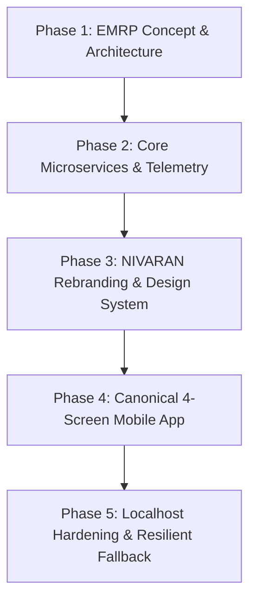
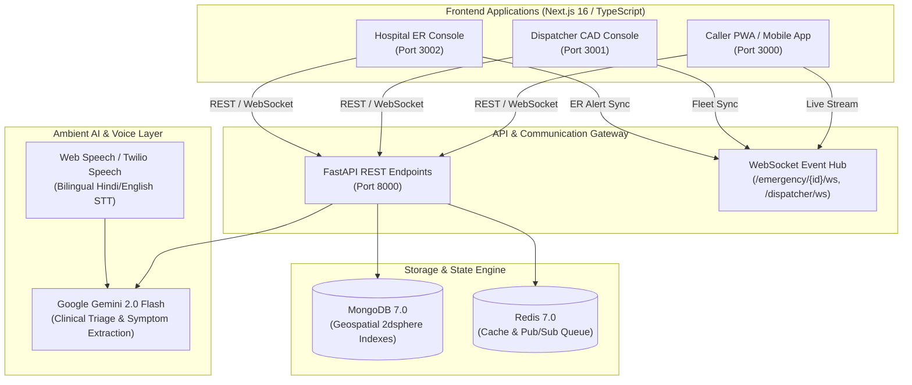
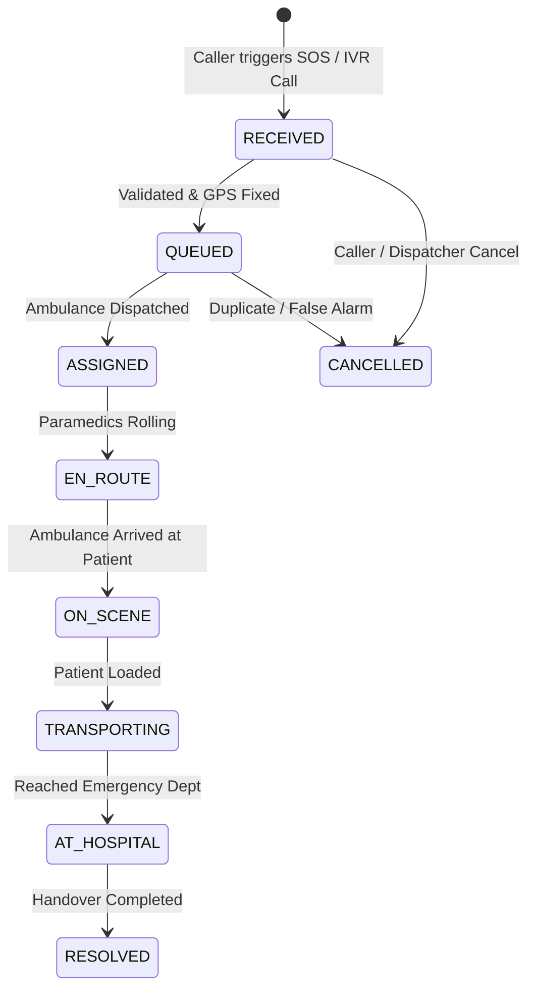

# NIVARAN (निवारण) — Comprehensive Project Documentation & Technical Guide
*Next-Generation Emergency Medical Response Platform & Computer-Aided Dispatch (CAD) Ecosystem*

---


## 1. Executive Summary & Project Overview

### 1.1 The Golden Hour Challenge
In emergency medicine, the **"Golden Hour"** defines the initial sixty-minute window following traumatic injury or acute medical distress (e.g., acute myocardial infarction, acute ischemic stroke, severe polytrauma) where definitive medical intervention delivers the highest rate of survivability. 

In traditional emergency response systems across India (such as 108 / 112 services), this golden hour is severely degraded by three systemic friction points:
1. **The Location Articulation Friction**: Panicked callers struggle to describe their exact location over voice calls in chaotic environments or unstructured urban geographies.
2. **Dispatcher Bottlenecks & Triage Delays**: Manual symptom transcription, delayed classification, and lack of real-time fleet availability cause delayed ambulance dispatches.
3. **The Hospital Information Vacuum**: Emergency departments receive critical trauma and cardiac patients with zero pre-arrival telemetry, resulting in lost prep time for Cath Labs, operating theaters, and resuscitation bays.

### 1.2 The NIVARAN Solution
**NIVARAN (निवारण)** is an end-to-end emergency medical dispatch and pre-hospital coordination platform engineered to eliminate preventable pre-hospital mortality. It combines:
- A zero-friction, ambient-location **Citizen Mobile Application (PWA)** with a 1-second hold SOS trigger and an in-app bilingual AI Voice Hotline.
- A **Computer-Aided Dispatch (CAD) Console** for 112/108 emergency operations centers featuring geospatial nearest-unit routing and automated severity triaging.
- A **Hospital Emergency Console** providing receiving emergency departments with real-time inbound casualty pre-notification, pre-arrival patient vitals, and facility readiness staging.
- A robust, high-throughput **FastAPI + WebSocket + MongoDB Geospatial Backend** with Celery background worker queues and Gemini AI integration.

---

## 2. Project Evolution & Chronological Journey (From Start to Current)



### Phase 1: Conceptualization & Initial EMRP Prototype
The platform began as the **Emergency Medical Response Platform (EMRP)**. The initial goal was building an open, modular ambulance dispatch service to demonstrate computer-aided dispatch algorithms, Leaflet-based map tracking, and basic incident queues.

### Phase 2: Engine Development & Real-Time Telemetry
- Implemented **FastAPI** backend with MongoDB geospatial (`2dsphere`) indexes to calculate sub-second `$nearSphere` queries for nearest available ambulances.
- Created bi-directional **WebSocket** event broadcast channels allowing dispatchers and callers to share live telemetry.
- Integrated **Twilio Voice IVR** and **Gemini AI** for automated natural-language voice triage over telephonic channels.

### Phase 3: The NIVARAN Rebranding & Visual Identity Transformation
To elevate the product into a mission-grade, trusted public safety platform, the platform transitioned from "EMRP" to **NIVARAN**:
- Replaced all legacy assets across mobile, dispatcher console, hospital console, website, and backend.
- Established a unified, high-contrast, accessible brand palette:
  - **Deep Navy (`#0B1B3A`)**: Structural authority and readability.
  - **Cobalt Blue (`#0A3D9C`)**: Secondary accents, action states, and navigation highlights.
  - **Emergency Crimson (`#E5262B`)**: High-stakes emergency SOS triggers and critical severity indicators.
  - **Ice Bone (`#F3F6FB`)**: Soft, clean background reducing eye strain during high-stress operations.
  - **Mint Success (`#E3F4EC` / `#11684F`)**: Confirmed states, GPS locks, and successful dispatches.

### Phase 4: Canonical 4-Screen Mobile Caller Application
Engineered the citizen mobile experience strictly adhering to the Product Requirements Document (PRD Section 7.1) and UI designs:
1. **Screen 1 (Permissions / CA-1)**: Ambient location permissions without asking users to register or explain their location.
2. **Screen 2 (Emergency Home / CA-2, CA-3, CA-4, CA-9)**: Instant severity pills, 1-second hold SOS button with animated SVG progress ring, hotline dialer, and bottom navigation.
3. **Screen 3 (In-App Voice Hotline / CA-7, VH-1 to VH-3)**: Real-time speech recognition, ambient symptom extraction ("Understood so far" tags), and one-tap emergency help submission.
4. **Screen 4 (Live Tracking / CA-8)**: Bold 4-minute ETA countdown, assigned vehicle & crew badge (`DL-01-AMB-1081 · ALS crew`), 4-step vertical progress timeline, and pre-arrival hospital notification alert.

### Phase 5: Localhost Hardening, Error Elimination & Resilient Fallback
- Replaced hardcoded cloud URLs with dynamic environment detection (`getApiBase()`, `getWsBase()`) to seamlessly switch between local execution (`http://localhost:8000/api/v1`) and production deployments.
- Resolved frontend runtime errors (`Failed to fetch`, `Cannot read properties of undefined (reading 'registration')`) by adding safe optional chaining and resilient mock fallbacks so frontends remain operational offline or during demo runs.
- Packaged full-system startup into `start_localhost.bat` for one-click local orchestration.

---

## 3. High-Level System Architecture



---

## 4. Component-by-Component Walkthrough & Features

### 4.1 Mobile Caller Application (Caller PWA)
*URL: `http://localhost:3000` | Directory: `frontend/caller-pwa`*

The Caller PWA is designed for extreme speed and zero cognitive friction. In a life-threatening crisis, callers cannot navigate complex menus or fill forms.

---

#### Screen 1: First-Run Permissions (CA-1) — "Help that finds you."


- **Purpose**: Establishes background device permissions on initial launch so that when an emergency happens, help finds the user instantly.
- **Key Features**:
  - **Ambient Location**: Requests high-precision GPS (`navigator.geolocation`) with accuracy display.
  - **Microphone Access**: Pre-authorizes audio input for the interactive Voice Hotline.
  - **Emergency Push Notifications**: Enables push alerts for ambulance dispatch, ETA changes, and arrival.
  - **Direct 112 Fallback**: Persistent link allowing instant cellular dialing to national emergency services.

---

#### Screen 2: Emergency Home / SOS (CA-2, CA-3, CA-4, CA-9) — "Need help?"


- **Purpose**: The primary screen seen during an active emergency.
- **Key Features**:
  - **Signal Accuracy Chip**: Real-time beacon displaying GPS fix quality (`Good · 12 m`).
  - **Severity Selector Pills**:
    - `Critical`: Cardiac arrest, severe trauma, respiratory failure (default selected).
    - `High`: Uncontrolled hemorrhage, fracture with shock, severe asthma.
    - `Medium`: Moderate injuries, non-acute fractures.
    - `Low`: Mild trauma, stable transport.
  - **1-Second Hold SOS Button**:
    - Giant 230px circular button in Emergency Crimson (`#E5262B`).
    - Circular SVG progress ring that fills smoothly across 1000ms.
    - Prevents accidental pocket presses while allowing rapid emergency triggering with haptic feedback.
  - **Secondary Actions**:
    - *"Speak to the hotline"*: Transitions directly to the AI Voice Hotline.
    - *"Call 112"*: Native telephone dialer trigger.
  - **Bottom Navigation Bar**: Persistent navigation between `Help`, `Track`, and `Settings`.

---

#### Screen 3: In-App Voice Hotline (CA-7, VH-1 to VH-3)


- **Purpose**: Ambient conversational interface for callers who cannot type or need hands-free assistance.
- **Key Features**:
  - **Bilingual Support**: Toggle between English and हिन्दी (`hi-IN`).
  - **AI Voice Prompt**: Prompts *"What is the case?"* using clean conversational speech synthesis.
  - **Live Speech Transcription**: Real-time Web Speech recognition captures statements like: *"My father has chest pain and is sweating a lot."*
  - **"Understood so far" Extraction Card**:
    - Automatically parses clinical entities into tags: `[Critical]` `[Chest pain]` `[Sweating]`.
    - Confirms `Location locked · 28.6139, 77.2090`.
  - **One-Tap Dispatch**: *"Send help now"* dispatches nearest unit and switches to tracking.

---

#### Screen 4: Live Ambulance & Hospital Tracking (CA-8)


- **Purpose**: Provides calm, transparent, real-time reassurance to callers awaiting ambulance arrival.
- **Key Features**:
  - **Interactive Route Map**: Top graphic displaying the approaching ambulance route and live GPS beacon.
  - **Prominent ETA Countdown**: Large bold countdown ticker (`4 min`) updating in real time.
  - **Vehicle & Crew Identification**: Shows vehicle registration and capability badge: `DL-01-AMB-1081 · ALS crew`.
  - **4-Step Progress Stepper**:
    1. `Request received` (Completed checkmark)
    2. `Ambulance assigned` (Completed checkmark)
    3. `On the way` (Active pulsating state)
    4. `Arrived` (Pending state)
  - **Receiving Hospital Alert Card**: Displays receiving facility readiness: `Hospital has been notified — AIIMS Trauma Centre receiving pre-arrival telemetry`.

---

### 4.2 Dispatcher Command Console (CAD)
*URL: `http://localhost:3001` | Directory: `frontend/dispatcher`*


The Dispatcher Console is the operational nerve center for emergency operations officers:
- **Real-Time Incident Triage Queue**:
  - Streams incoming emergency incidents from mobile app, voice hotline, and 112 trunk lines.
  - Visual color-coded severity pills: Red (`CRITICAL`), Orange (`HIGH`), Yellow (`MEDIUM`), Blue (`LOW`).
  - Filters by incident status: `ALL`, `QUEUED`, `ASSIGNED`, `EN_ROUTE`, `ON_SCENE`.
- **Interactive Geospatial CAD Map**:
  - Powered by **Leaflet** with customized dark high-contrast emergency tiles.
  - Live markers for incident coordinates (pulsing crimson pins), ambulances (categorized by ALS / BLS), and regional trauma hospitals.
- **Automated Unit Recommendation Engine**:
  - Calculates Haversine and road network distances to all available ambulances.
  - Checks medical capability matching (e.g. ALS with ventilator required for acute cardiac incidents).
  - Displays top 3 recommended units with distance, ETA, and crew capabilities.
- **Two-Leg Route Metrics Calculation**:
  - **Leg 1**: Ambulance base to patient incident scene.
  - **Leg 2**: Incident scene to designated hospital emergency department.
- **Manual Override & Reassignment**:
  - Dispatchers can manually reassign vehicles, cancel false alarms, or update triage notes on the fly.

---

### 4.3 Hospital Emergency Department Console
*URL: `http://localhost:3002` | Directory: `frontend/hospital`*


The Hospital Console bridges the gap between field ambulances and emergency department physicians:
- **Inbound Casualty Radar**:
  - Real-time countdown of inbound ambulances with patient details, suspected clinical condition, and trauma tier.
  - Alerts trauma teams 10–15 minutes before physical arrival.
- **Facility Capacity Management**:
  - Live inventory tracking for ICU beds, General Acute beds, Trauma Bays, and Cath Lab availability.
  - Allows the hospital to broadcast diversion status or immediate readiness to dispatchers.
- **Direct Paramedic Link**:
  - Allows emergency physicians to view field telemetry and provide tele-medical guidance prior to arrival.

---

### 4.4 Backend Microservices Architecture & State Machines
*Directory: `backend` | API Docs: `http://localhost:8000/api/docs`*

#### Incident State Machine (FSM)
To maintain clinical and audit integrity, incident states follow a strict non-reversible transition lifecycle:



#### Ambulance Fleet State Machine (FSM)
Ambulances transition through operational states to prevent double-booking:
- `AVAILABLE`: Ready at station or cruising in sector.
- `DISPATCHED`: Assigned to incident; proceeding to scene.
- `ON_SCENE`: Paramedics providing on-scene resuscitation.
- `TRANSPORTING`: Patient in transit to hospital with live telemetry.
- `AT_HOSPITAL`: Patient handover in progress.
- `OUT_OF_SERVICE`: Maintenance, refueling, or disinfection.

---

## 5. Technology Stack & Technical Specifications

| Layer | Technologies Used | Key Purpose |
|---|---|---|
| **Mobile Caller PWA** | Next.js 16, React 19, TypeScript, CSS Variables, Web Speech API | Zero-lag responsive mobile app with hold-to-send SOS and voice triage |
| **Dispatcher Console** | Next.js 16, React 19, Leaflet, React-Leaflet, Lucide Icons | Multi-monitor Computer-Aided Dispatch (CAD) console |
| **Hospital Console** | Next.js 16, React 19, Tailwind/CSS System, WebSockets | Inbound casualty triage & facility capacity monitor |
| **Backend Framework** | Python 3.12, FastAPI, Uvicorn, Pydantic v2 | High-concurrency async REST and WebSocket server |
| **Database** | MongoDB 7.0 (Geospatial `2dsphere` Indexing) | Sub-second spatial queries (`$nearSphere`) and document storage |
| **Task Queue & Cache** | Redis 7.0, Celery | Async background routing, outbox event publishing, and rate limiting |
| **AI & NLP** | Google Gemini 2.0 Flash, Web Speech API | Real-time clinical entity extraction and natural language triage |
| **Telephony / Voice** | Twilio Voice Webhooks, TwiML, Python SDK | Telephonic emergency calling and IVR triage |

---

## 6. Localhost Deployment & Execution Guide

### 6.1 Prerequisites
- **Node.js** (v18.0 or higher) & **npm**
- **Python** (v3.10 or higher) & **pip**
- **MongoDB** running locally or via cloud connection string (`mongodb://localhost:27017/nivaran`)

### 6.2 One-Click Startup (Windows)
Run the bundled batch file in the repository root:
```bat
start_localhost.bat
```
This script automatically opens 4 coordinated terminal sessions:
1. **Backend API**: `http://localhost:8000` (FastAPI + Swagger Docs at `/api/docs`)
2. **Caller PWA**: `http://localhost:3000` (Mobile app view)
3. **Dispatcher Console**: `http://localhost:3001` (CAD workstation)
4. **Hospital Console**: `http://localhost:3002` (ER pre-arrival dashboard)

### 6.3 Manual Service Commands
```bash
# 1. Backend Service
cd backend
python -m uvicorn app.main:app --port 8000 --reload

# 2. Caller Mobile Application
cd frontend/caller-pwa
npm run dev -- -p 3000

# 3. Dispatcher Console
cd frontend/dispatcher
npm run dev -- -p 3001

# 4. Hospital Console
cd frontend/hospital
npm run dev -- -p 3002
```

---

## 7. Key Features Summary Checklist

- [x] **Zero-Registration Emergency Access**: Instant access without login walls or passwords during crisis.
- [x] **Ambient Location Lock**: High-accuracy GPS coords transmitted automatically (`Good · 12 m`).
- [x] **1-Second Hold-to-Send SOS**: High-reliability physical press mechanism with animated SVG progress ring.
- [x] **Bilingual AI Voice Hotline**: Instant speech recognition in English & Hindi with clinical entity extraction.
- [x] **Real-Time CAD Geospatial Mapping**: Dispatcher view with live moving ambulances, hospital markers, and incident clusters.
- [x] **Two-Leg Route Optimization**: Dynamic computation for scene response and subsequent hospital transport.
- [x] **Inbound ER Pre-Arrival Notifications**: Eliminates hospital triage delays with real-time payload feeds.
- [x] **Emergency 112 Fallback Integration**: Instant fallback to direct cellular emergency calling across all screens.
- [x] **Resilient Local & Offline Execution**: Frontends feature graceful degradation with fallback demo states.

---

*NIVARAN Emergency Medical Response Platform — Dedicated to saving lives across the Golden Hour.*

